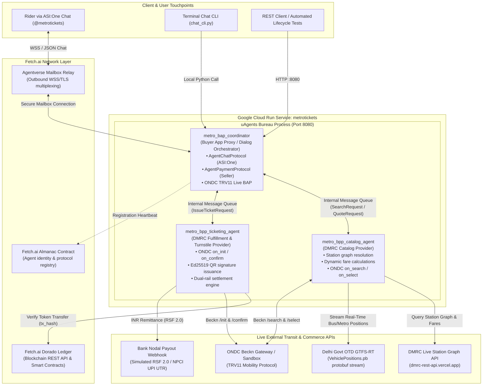
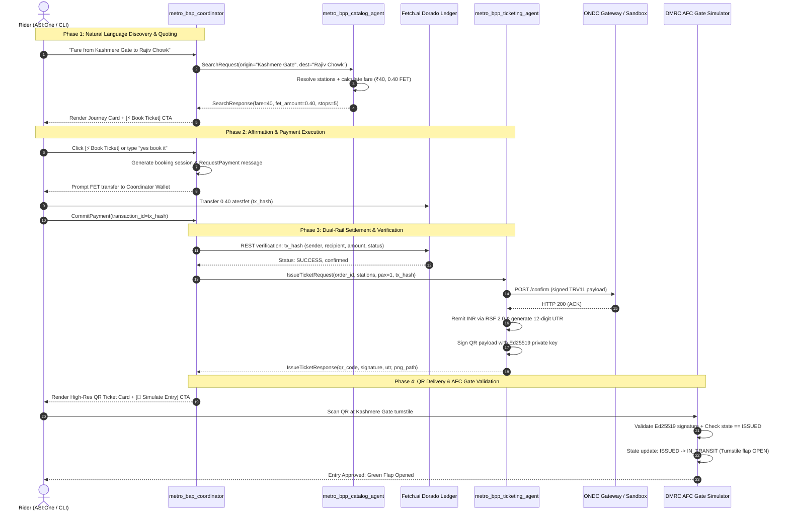
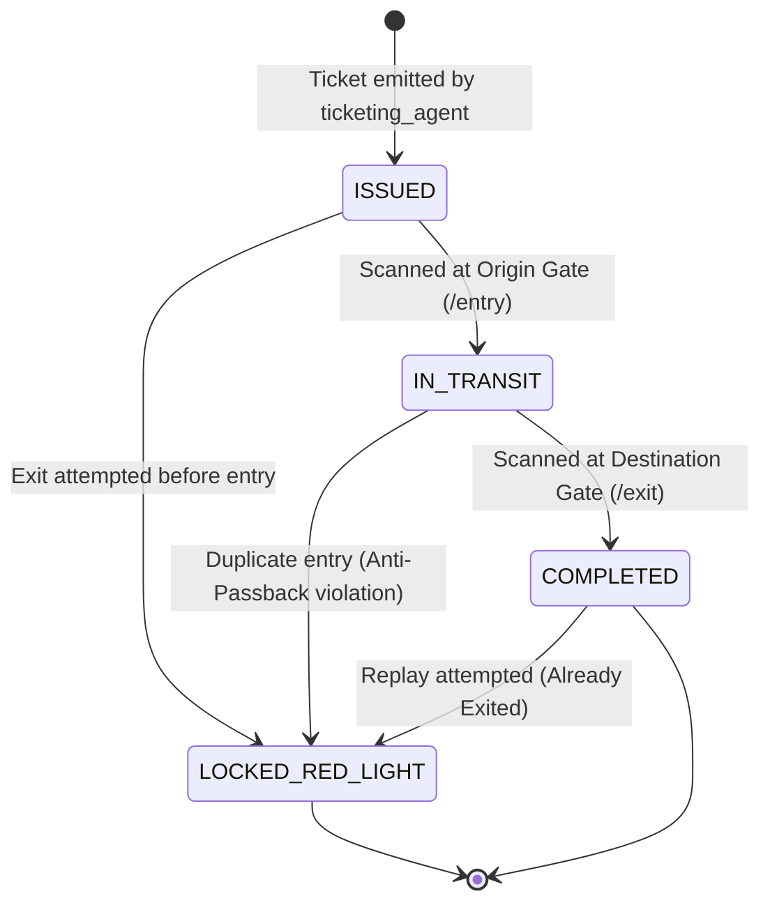

# System Architecture & Multi-Agent Protocol Specification

This document provides a technical deep-dive into the architectural design, protocol interfaces, cryptographic security, and multi-rail settlement mechanics of the **`metrotickets`** system.

---

## 1. High-Level System Architecture

The system coordinates three autonomous agents executing inside a single [Fetch.ai uAgents Bureau](file:///Users/ashwinsharma/hotcrunch/fetch-a-thon-dmrc/metro_booking_agents.py). The agents interface with the **Fetch.ai Dorado Testnet**, the **ASI:One conversational UI**, the **Delhi Government Open Transit Database (OTD)**, and the **ONDC Mobility (TRV11 v2.1.0)** network.



---

## 2. Multi-Agent Bureau Roles & Responsibilities

The three agents model the decentralized **Buyer App (BAP)** and **Seller Platform (BPP)** separation specified by India's Open Network for Digital Commerce (ONDC):

| Agent Identifier | Beckn / Network Role | Protocols Implemented | Key Module | Primary Responsibilities |
| :--- | :--- | :--- | :--- | :--- |
| **`metro_bap_coordinator`** | Buyer App (BAP) Proxy & UI Master | `AgentChatProtocol`<br>`AgentPaymentProtocol` (role="seller")<br>`ONDC_TRV11_LiveBAPProtocol` | [coordinator_agent.py](file:///Users/ashwinsharma/hotcrunch/fetch-a-thon-dmrc/agents/coordinator_agent.py) | • Maintains rider chat session state.<br>• Translates natural language into Beckn search queries.<br>• Renders interactive ASI:One Chat Cards (routes, fares, tickets).<br>• Dispatches `RequestPayment` and validates rider FET tx on Dorado.<br>• Serves HTTP REST endpoints and QR asset downloads. |
| **`metro_bpp_catalog_agent`** | Seller Platform (BPP) Catalog Provider | `ONDC_TRV11_LiveCatalogProtocol` | [catalog_agent.py](file:///Users/ashwinsharma/hotcrunch/fetch-a-thon-dmrc/agents/catalog_agent.py) | • Interfaces with live DMRC station graph (254 active stations).<br>• Streams real-time telemetry from Delhi OTD `VehiclePositions.pb`.<br>• Computes station stops, interchanges, line colors, and base fares.<br>• Formats signed Beckn `on_search` and `on_select` catalog items. |
| **`metro_bpp_ticketing_agent`** | Seller Platform (BPP) Ticketing Provider | `ONDC_TRV11_LiveTicketingProtocol`<br>`AgentPaymentProtocol` (role="buyer") | [ticketing_agent.py](file:///Users/ashwinsharma/hotcrunch/fetch-a-thon-dmrc/agents/ticketing_agent.py) | • Validates incoming payment receipts on the Dorado ledger.<br>• Executes DMRC RSF 2.0 INR remittance and issues NPCI UPI UTR.<br>• Generates Ed25519-signed QR tokens (`DMRC-QR://v1?...`).<br>• Handles Beckn `on_init` and `on_confirm` order dispatch.<br>• Enforces AFC turnstile gate state transitions (`ISSUED` $\rightarrow$ `IN_TRANSIT` $\rightarrow$ `COMPLETED`). |

---

## 3. End-to-End Transaction Sequence

The sequence diagram below illustrates the complete lifecycle from initial chat discovery to AFC turnstile entry:



---

## 4. Dual-Rail Settlement Architecture

To bridge decentralized AI micro-transactions with Indian public transit compliance, settlement operates across two parallel, coupled rails:

```
                            DUAL-RAIL SETTLEMENT ARCHITECTURE
   
   ┌────────────────────────────────────────────────────────────────────────┐
   │ Rail 1: Fetch.ai Dorado Blockchain Settlement (atestfet / FET)         │
   │                                                                        │
   │  Rider Wallet  ──────────(0.01 FET per ₹1 INR)─────────>  Coordinator  │
   │  (ASI:One / Keplr)                                        Wallet       │
   │                                                                        │
   │  • Verified via Dorado Ledger REST API                                 │
   │  • Exact recipient match check (COORDINATOR_ADDRESS)                   │
   │  • Exact or greater amount check (fare_in_atestfet)                    │
   │  • Strict anti-replay: transaction hash stored in single-use registry  │
   └───────────────────────────────────┬────────────────────────────────────┘
                                       │
                              Triggers Instant Remittance
                                       │
                                       ▼
   ┌────────────────────────────────────────────────────────────────────────┐
   │ Rail 2: BAP Nodal Escrow ──> DMRC Account (INR via ONDC RSF 2.0)       │
   │                                                                        │
   │  BAP Nodal Bank A/C  ──────(Exact Fare ₹INR)──────>  DMRC BPP Bank A/C  │
   │  (YES BANK: 000180900001234)                         (SBI: 10891234567) │
   │                                                                        │
   │  • Beneficiary: Delhi Metro Rail Corporation Ltd (VPA: dmrc.ondc@sbi)  │
   │  • Settlement Mechanism: UPI / NEFT Payout Webhook                     │
   │  • Produces: 12-digit NPCI Bank UTR (e.g. 202610260421)                │
   │  • Signed into ONDC:TRV11 /confirm payload for reconciliation audits  │
   └────────────────────────────────────────────────────────────────────────┘
```

---

## 5. Cryptographic Ticket Security & Turnstile Lifecycle

### 5.1 QR Code Token Specification
Tickets are encoded as URI strings adhering to the following structure:
```text
DMRC-QR://v1?oid=<ORDER_ID>&orig=<ORIGIN>&dest=<DEST>&fare=<INR>&fet=<FET>&tx=<TX_HASH>&utr=<UTR>&ts=<TIMESTAMP>&pax=<PAX>&sig=<ED25519_HEX_SIGNATURE>
```

### 5.2 Turnstile Finite State Machine (FSM)
The Automatic Fare Collection (AFC) validator in `common/ticket_verifier.py` enforces a strict 4-state lifecycle:



### 5.3 Threat Mitigation Matrix

| Security Threat | Attack Vector | System Defense Mechanism |
| :--- | :--- | :--- |
| **Ticket Payload Tampering** | Attacker modifies `pax=1` to `pax=5` or alters destination station in the QR string. | Turnstile computes SHA-256 hash over canonical fields and verifies Ed25519 signature using `TICKET_SIGNING_PUBLIC_KEY`. Cryptographic mismatch triggers `ALARM_TAMPERED_QR_RED_LIGHT`. |
| **Double-Spending / Replay** | Attacker presents the same QR code twice at the entry turnstile to let a second passenger in. | **Anti-Passback Rule**: Ticket state transitions to `IN_TRANSIT` upon first entry. Subsequent entry scans are rejected with `ANTI_PASSBACK_BLOCKED_RED_LIGHT`. |
| **Blockchain Payment Replay** | Attacker re-submits a previously confirmed `tx_hash` to claim a new ticket. | Single-use transaction registry (`common/fet_payment.py`) records all consumed hashes. Re-used hashes are rejected immediately. |
| **Premature Exit Scan** | Attacker attempts to scan at exit gate without passing origin entry gate. | Turnstile asserts state == `IN_TRANSIT`. If state is `ISSUED`, gate returns `INVALID_FLOW_CANNOT_EXIT_BEFORE_ENTRY`. |

---

## 6. Directory Structure & Modular Layout

```
fetch-a-thon-dmrc/
├── Dockerfile                   # Production Python 3.12 Cloud Run container spec
├── metro_booking_agents.py      # Unified Bureau runner hosting all 3 agents on :8080
├── chat_cli.py                  # Interactive CLI with ASCII QR rendering & gate testing
├── test_full_lifecycle.py       # Single-command 7-stage automated E2E test suite
├── agent_readme.md              # Public documentation published to Agentverse / ASI:One
│
├── agents/                      # Multi-Agent Implementations
│   ├── coordinator_agent.py     # BAP Dialog Manager, ASI:One Chat, Dorado payment seller
│   ├── catalog_agent.py         # DMRC live station catalog & ONDC TRV11 search/select
│   ├── ticketing_agent.py       # Order fulfillment, RSF 2.0 remittance, Ed25519 QR signing
│   └── chat_cards.py            # Rich interactive UI cards (routes, fares, tickets)
│
├── common/                      # Shared Services & Core Business Logic
│   ├── config.py                # Multi-env settings (dev, test, prod) & security audits
│   ├── dmrc_client.py           # Live DMRC station graph client (254 stations, fares, stops)
│   ├── otd_client.py            # Real-time Delhi OTD GTFS-RT protobuf stream consumer
│   ├── ondc_client.py           # ONDC TRV11 v2.1.0 client with Ed25519 request signing
│   ├── fet_payment.py           # Dorado blockchain transaction reader & anti-replay registry
│   ├── ticket_verifier.py       # Cryptographic QR validator & AFC turnstile gate simulator
│   └── models.py                # Typed dataclasses for sessions, quotes, and tickets
│
├── docs/                        # Project Documentation
│   ├── DEPLOYMENT_GCP.md        # Google Cloud Run & Docker operations manual
│   ├── SYSTEM_ARCHITECTURE.md   # System architecture, sequence diagrams & security
│   ├── TAKE_TO_PRODUCTION.md    # Production readiness checklist, ONDC onboarding & roadmap
│   └── PRODUCTION_HANDOFF.md    # Technical handoff notes
│
├── scripts/                     # Operational & Diagnostic Utilities
│   ├── generate_production_keys.py # High-entropy Ed25519 & X25519 key generator
│   ├── register_agentverse.py      # Automated Agentverse Almanac registration script
│   └── verify_prod_readiness.py    # Pre-deployment validation gate
│
└── tickets/                     # Generated ticket PNGs and state storage (dev/test/prod)
```
